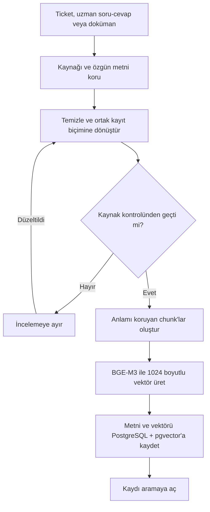
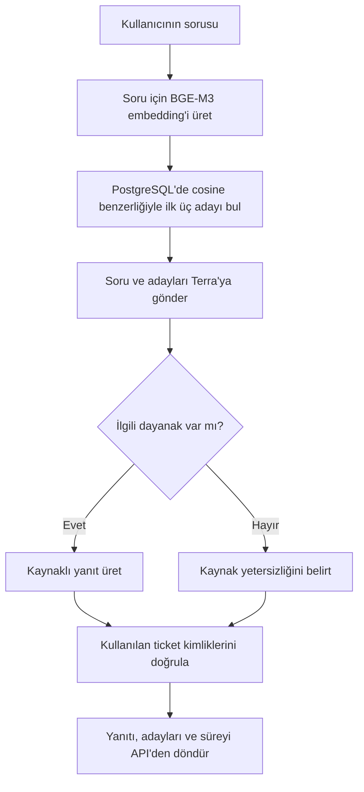

# RAG akışı — Akıllı Servis Masası ve Sistem Uzmanı Chatbot

Proje: PRJIC20260201 · Tarih: 22 Ekim 2026 · Sürüm: 0.6

Bu belge mevcut 20 ticketlık yerel RAG pilotunu ve henüz yapılmamış uygulama adımlarını ayırır. ER karşılığı: [ER_Taslagi.md](ER_Taslagi.md). Model gerekçeleri: [Model_Secimi.md](Model_Secimi.md). API ve ilk düzenli test: [PILOT_API_VE_DEGERLENDIRME.md](PILOT_API_VE_DEGERLENDIRME.md).

RAG, kullanıcının sorusuna benzeyen bilgi kayıtlarını bulup bunları yanıt modeline kaynak olarak vermektir. Kaynak veriye model eğitimi uygulanmaz. Pilot; Cloudflare Workers AI üzerindeki `@cf/baai/bge-m3` embedding modeli, PostgreSQL + pgvector araması ve OpenAI Responses API üzerindeki `gpt-5.6-terra` yanıt modelini kullanır.

## 1. Bilgi tabanını hazırlama

- Ticket yorumlarından `problem`, `solution`, `resolution`, `resolution_confirmed`, `source_comment_seq`, `solution_scope` ve `limitations` alanları çıkarılır; kaynak yorumlarla karşılaştırılır.
- Mevcut 20 kısa ticketın her biri tek chunk'tır. Aranan metin `Problem + Solution` birleşimidir; sonuç, doğrulama ve sınırlama alanları yanıt üretiminde ayrıca kaynak bağlamına eklenir. Uzun belge veya çoklu chunk henüz sınanmadı.
- Embedding çağrısı başarısızsa eksik kayıt aramaya açılmaz. Model kimliği, 1024 boyut, metin ve içerik hash'i chunk ile birlikte tutulur.
- Pilotun ilk 10 vektörü yerel cache'den, ek 10 vektörü ayrı embedding adımından PostgreSQL'e aktarılmıştır. Çalışan API aramasında bellek cache'i değil, PostgreSQL + pgvector kullanılır. Eski `--memory` modu yalnızca karşılaştırma içindir.

## 2. Kullanıcının sorusunu yanıtlama

- Soru ve kayıtlar aynı embedding modeliyle 1024 boyutlu vektörlere dönüştürülür. Cosine benzerliği yalnızca sıralama değeridir; doğruluk yüzdesi değildir. İlk üç adayın hepsi ilgili olmak zorunda değildir.
- `api.py` içindeki yerel `/ask` endpoint'i `rag_service.py` aracılığıyla LangChain Runnable zincirini çağırır. Zincirde embedding, PostgreSQL araması ve yanıt üretimi ayrı adımlardır. Mevcut OAuth/giriş kodu yeniden yazılmamıştır.
- Genel model yönergesi yalnızca ilgili ticketları dayanak almayı, ilgisiz adayları reddetmeyi ve eksik ayrıntı uydurmamayı ister. Ticket metinleri güvenilmeyen veridir; içlerindeki talimatlar uygulama kuralı sayılmaz.
- `resolution_confirmed=false` müşteri onayı olarak sunulmaz; `workaround` kalıcı çözüm, `diagnostic_approach` eksiksiz uygulama tarifi sayılmaz. Kaynakta olmayan SQL komutu, cache değeri, dosya yolu, port, sürüm veya yapılandırma anahtarı uydurulmaz.
- Model çıktısı `response.completed` gelmeden başarı sayılmaz. Kullanılan ticket kimlikleri adaylar arasında mı ve yanıt metninde geçiyor mu ayrıca kontrol edilir. `retrieved_ticket_ids` arama adaylarıdır; `used_ticket_ids` yanıtın gerçekten dayandığı kaynaklardır.
- OpenAI isteği `store:false`, `stream:true` ve `instructions` alanıyla gönderilir. ChatGPT ve Cloudflare kimlik bilgileri Git deposunun dışında tutulur. API yalnızca `127.0.0.1` üzerinde kullanılmalıdır; kullanıcı yetkilendirmesi henüz yoktur.
- API'nin isteğe bağlı `expertise_mode` alanı `service_desk`, `windows_server` ve `oracle_db` seçer. Ortak kaynak kuralları korunarak modele alana özel yönergeler eklenir; yanıt seçilen modu ve `prompt_version` değerini döndürür. Altı yeni prompt testi ve kullanıcının iki gerçek API kontrolü geçti: Windows/BitLocker sorusunda çekimserlik, Oracle/sequence sorusunda `1010047.0` kaynağı ve doğrulama sınırı korundu. Mod seçimi kaynak havuzunu genişletmez veya aramayı alana göre filtrelemez. Ayrıntılar [PROMPT_YAPISI.md](PROMPT_YAPISI.md) içindedir.
- MSSQL bağlantısı, `ServisMasasiApp` içindeki beş tablo ve kullanıcı/sohbet/mesaj veri erişim katmanı hazırdır. API henüz sohbet geçmişini bu tablolara yazmaz; doğrulanmış kullanıcı kimliği, API bağlantısı, JWT ve kullanıcı arayüzü sonraki aşamalardır.

## 3. Çalışan pilotun sonuçları

9 Ekim'de önceden hazırlanmış 8 ilgili ve 2 kaynakta karşılığı olmayan soruyla değerlendirme yapıldı. İlgili soruların beklenen ticketı ilk üçte **8/8**, ilk sırada da **8/8** bulundu. Kaynaksız iki soruda model ilgili dayanak olmadığını belirtti (**2/2**). On sorunun ortalama süresi yaklaşık **10,1 saniye** idi. Yanıtlar onaylı ticket özetleriyle elle karşılaştırıldı; bu küçük sette kaynak dışı teknik talimat bulunmadı. Ayrıntılar ve her sorunun sonucu [PILOT_API_VE_DEGERLENDIRME.md](PILOT_API_VE_DEGERLENDIRME.md) içindedir.

22 Ekim'deki kod ayrımından sonra üç çevrimdışı regresyon testi geçti. Gerçek Chrome sorusunda `1005127.0` ilk aday ve kullanılan kaynak oldu. Kullanıcı ayrıca UAT ticketı `1007444.0` ile kaynaklı yanıtı, BitLocker sorusunda kaynak yetersizliğini ve boş sorunun `422` ile reddedilmesini API üzerinden kontrol etti.

Bu sonuçlar 20 kısa kayıttan oluşan yerel pilot içindir; Windows Server/Oracle uzmanlığı, farklı kurum verisi veya üretim yükü için genel başarı garantisi değildir.

## 4. Sonraki doğrulamalar

1. Uzun kayıtlar için problem-çözüm bütünlüğünü koruyan çoklu chunk stratejisini sınamak.
2. Windows Server ve Oracle kaynak kapsamını ve hedef sürümleri belirlemek; eklenen uzmanlık yönergelerini gerçek yanıtlarla test etmek.
3. En az 10 servis masası, 5 Windows Server ve 5 Oracle sorusundan bağımsız bir değerlendirme seti hazırlamak.
4. Aramada doğru kaynağın ilk sıralarda bulunmasını ve yanıtın kaynak uyumunu ayrı ölçmek.
5. Yanıt süresi, kota/bağlantı hataları, eksik kaynak davranışı ve kullanıcı geri bildirimini izlemek.
6. Yerel pilotun ötesine geçmeden önce JWT, sohbet sahipliği, MSSQL geçmişi ve güvenli dağıtımı tamamlamak.

## 5. Kaynaklar

- [Cloudflare BGE-M3 model sayfası](https://developers.cloudflare.com/workers-ai/models/bge-m3/)
- [Cloudflare OpenAI uyumlu embeddings uçları](https://developers.cloudflare.com/workers-ai/configuration/open-ai-compatibility/)
- [OpenAI model kataloğu ve Responses API akışı](https://developers.openai.com/siwc/token-sharing-open-source/models-and-inference)
- [OpenAI önizleme sınırlamaları](https://developers.openai.com/siwc/token-sharing-open-source/preview-limitations)
