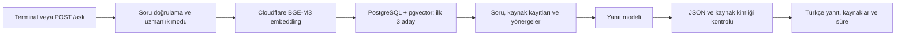

# Akıllı Servis Masası ve Sistem Uzmanı Chatbot

Teknik destek sorularına geçmiş ticket kayıtlarını kaynak göstererek Türkçe yanıt üreten bir staj projesidir. RAG (Retrieval-Augmented Generation) yaklaşımıyla soru önce bilgi tabanında aranır; bulunan kayıtlar dil modeline bağlam olarak verilir. Kaynaklar üzerinde model eğitimi yapılmaz.

Bu README, 6 Kasım 2026 tarihinde uzmanlık kaynaklarının ikinci aktarımıyla güncellenmiştir. Proje şu anda Windows üzerinde terminalden ve yerel FastAPI servisinden kullanılabilen bir pilottur.

## Mevcut durum

| Bileşen | Durum |
|---|---|
| Kaynaklı soru–yanıt | PostgreSQL + pgvector araması ve bulut model yanıtı bağlı |
| API | `POST /ask`; soru, uzmanlık modu, kaynak kimlikleri ve işlem süresi |
| RAG zinciri | LangChain Runnable ile embedding → arama → yanıt |
| Uzmanlık modları | `service_desk`, `windows_server`, `oracle_db` |
| MSSQL | Kullanıcı, sohbet ve mesaj erişim katmanı hazır; API'ye henüz bağlı değil |
| Kayıt | `POST /auth/register`; e-posta/parola kontrolü ve salted hash ile MSSQL kayıt |
| Giriş / oturum | `/auth/login`, `/auth/me`, 30 dakikalık JWT; `/ask` giriş gerektirir |
| Arayüz | Streamlit henüz uygulanmadı |

**6 Kasım ikinci aktarım kontrolü: 191 Mendeley ticketı + 22 Windows Server ve 11 Oracle soru–cevabı = 224 onaylı/aramaya hazır kayıt ve chunk.** Kaynak türü, alanı, yazar ve ayrı soru/cevap lisansları korunur. QA’ların yalnız incelenmiş açıklama/teşhis özetleri indekslenir; ham cevap kodları modele verilmez. Kayıtlar üzerinde model eğitimi yapılmaz.

314 soru–cevap adayından toplam 40 kayıt incelendi; 33’ü sınırlı açıklama/teşhis kapsamında eklendi, 7’si elendi. Henüz incelenmemiş 274 aday vardır. İkinci partide 30 kaydın 26’sı eklendi; 4’ü dışarıda bırakıldı. Ham veri ve embedding dosyaları yerelde Git dışında tutulur; temiz klon 224 kaydı kendiliğinden oluşturmaz. [Saklama, alan filtreleri ve API kaynak atıfları](UZMANLIK_VERILERININ_KULLANIMI.md).

## Nasıl çalışır?



1. Soru, Cloudflare Workers AI üzerindeki `@cf/baai/bge-m3` modeliyle 1024 boyutlu vektöre dönüştürülür.
2. `knowledge_chunks` tablosunda cosine benzerliğiyle en yakın üç aday bulunur. Yalnızca `review_status=approved`, `index_status=ready` ve aynı embedding modeline sahip kayıtlar aranır.
3. Soru ve aday kayıtların problem, çözüm, sonuç, onay durumu ve sınırlamaları kodda yapılandırılmış `gpt-5.6-terra` modeline gönderilir. Model erişimi mevcut ChatGPT oturumu üzerinden yapılır.
4. Modelin JSON çıktısı ve kullandığı kaynak kimliklerinin adaylar arasında olması kontrol edilir. İlgili kaynak bulunmadığında `insufficient_context=true` beklenir.

Benzerlik skoru doğruluk yüzdesi değildir. Kaynak kimliği kontrolü de yanıtın bütün teknik ayrıntılarının doğru olduğunu tek başına kanıtlamaz. Yönergeler, müşteri onayını destek beyanından ve geçici çözümü kalıcı çözümden ayırmayı ister.

Üç mod aynı PostgreSQL tablolarını kullanır. Genel mod bütün 224 kaydı arar; Windows Server modu genel ticketlar + Windows QA’larını, Oracle modu genel ticketlar + Oracle QA’larını arar. Uzmanlık modları ayrı eğitilmiş modeller değildir. Kullanılan kayıtların bağlantı, yazar ve lisansları API’nin `sources` alanında döner.

## Gereksinimler

- Python 3.11 veya üzeri.
- Yerel API'nin kayıtlı oturum akışı için Windows. Kimlik bilgileri Windows hesabına bağlı DPAPI korumasıyla proje dışında saklanır.
- Docker Desktop ve Docker Compose: PostgreSQL 16 + pgvector için.
- Cloudflare Workers AI hesap kimliği ve erişim token'ı; kodun kullandığı modele erişebilen ChatGPT oturumu.
- MSSQL katmanını ayrıca kullanmak için SQL Server ve uygun ODBC sürücüsü. Mevcut yerel kurulum SQL Server 2022 Express ve ODBC Driver 18 kullanır.

Model çağrıları ağ erişimi ve ilgili hesaplarda kullanılabilir erişim/kota gerektirir. Depoda API isteği sırasında etkileşimli giriş başlatılmaz; ilk giriş terminalden yapılır.

## Kurulum ve çalıştırma

Komutlar proje kökünde PowerShell içindir. API'yi çalıştıracağın terminalde de `DATABASE_URL` tanımlı olmalıdır. Python kodu `.env` dosyasını otomatik yüklemez.

### 1. Python ortamı

```powershell
python -m venv .venv
.\.venv\Scripts\python.exe -m pip install -r requirements.txt
```

### 2. Veri dosyaları

Temiz bir klonda aşağıdaki yerel dosyaları ayrıca sağlamalısın:

| Dosya | Kullanımı |
|---|---|
| `tickets_pilot_10.csv` | İlk pilot kayıtları; `issueid`, `problem`, `solution` zorunlu alanlardır |
| `sample_utterances.csv` | Özgün Mendeley yorumları; ek ticket incelemesi ve aktarım kontrolü |
| `outputs_local/ticket_vektorleri.json` | İlk pilotun ürettiği embedding önbelleği |

CSV dosyaları UTF-8 veya UTF-8 BOM biçiminde olmalıdır. İlk pilot ve ham veri Git'e dahil değildir. **`tickets_reviewed_extra.csv` depoda bulunur**, ancak ek aktarım özgün yorumları ve ilk pilot CSV'sini de kontrol eder. Gerekli veriler sağlanmadan veri hazırlama adımları tamamlanamaz.

### 3. PostgreSQL şeması

```powershell
$env:DATABASE_URL = Read-Host "Yerel PostgreSQL baglanti adresi (DATABASE.md kurulumuna gore)"
docker compose up -d
.\.venv\Scripts\python.exe -m database.init_schema
.\.venv\Scripts\python.exe -m database.check_connection
```

Compose dosyasındaki bağlantı bilgileri yerel geliştirme içindir. Port `127.0.0.1:5432` üzerinde açılır ve veriler `postgres_data` volume'ünde saklanır. Şema komutu pgvector uzantısını oluşturduğu için bağlantı kontrolünden önce çalıştırılır.

### 4. İlk pilotu ve ek kayıtları aktar

Hazır ve CSV ile eşleşen bir önbellek yoksa önce embedding üret:

```powershell
.\.venv\Scripts\python.exe ticket_vektor_arama.py
```

Bu araç Cloudflare bilgilerini terminalden ister, 1–10 ticket için vektörleri üretir ve `outputs_local/ticket_vektorleri.json` dosyasına kaydeder. Arama sorusu aşamasına geldiğinde boş Enter ile çıkılabilir. Ardından:

```powershell
.\.venv\Scripts\python.exe -m database.import_pilot
.\.venv\Scripts\python.exe -m database.import_reviewed check
.\.venv\Scripts\python.exe -m database.import_reviewed embed
.\.venv\Scripts\python.exe -m database.import_reviewed import
```

`import_pilot` yeni embedding üretmez; önbelleği kullanır. Ek aktarımda `check` kaynak yorum numaralarını denetler, `embed` ek vektörleri hazırlar, `import` veritabanına yazar. Aynı kaynak sürümü ve ticket kimliğiyle tekrar aktarım kayıtları çoğaltmaz. Hazır bir yerel bilgi tabanını kullanıyorsan bu adımları her açılışta tekrarlaman gerekmez.

### 5. Terminalden giriş ve ilk soru

```powershell
.\.venv\Scripts\python.exe rag_ticket_pilotu.py
```

Terminalde sorunu gir; Cloudflare bilgilerini ve tarayıcıda ChatGPT girişini tamamla. Her çalıştırma tek soru yanıtlar. Windows'ta girişler korumalı olarak saklanır ve API aynı Windows kullanıcısının kayıtlarını kullanır.

```powershell
# Eski bellek içi aramayla karşılaştırma; ilk pilot CSV'si ve önbelleği gerekir
.\.venv\Scripts\python.exe rag_ticket_pilotu.py --memory

# Kayıtlı ChatGPT oturumunu veya Cloudflare bilgisini temizleme
.\.venv\Scripts\python.exe rag_ticket_pilotu.py --oturumu-kapat
.\.venv\Scripts\python.exe rag_ticket_pilotu.py --cloudflare-unut
```

### 6. API'yi başlat

```powershell
.\.venv\Scripts\python.exe -m uvicorn api:app --host 127.0.0.1 --port 8000
```

Etkileşimli API belgesi: [http://127.0.0.1:8000/docs](http://127.0.0.1:8000/docs).

Ayrı bir PowerShell penceresinden örnek istek:

```powershell
$body = @{
    question = "Chrome normal pencerede açılmayan URL gizli pencerede açılıyor. Kaynakta ne denenmiş?"
    expertise_mode = "service_desk"
} | ConvertTo-Json

Invoke-RestMethod -Uri "http://127.0.0.1:8000/ask" -Method Post `
    -ContentType "application/json; charset=utf-8" `
    -Body ([System.Text.Encoding]::UTF8.GetBytes($body)) | Format-List
```

`question` boş olamaz ve en fazla 2000 karakter olabilir. `expertise_mode` gönderilmezse `service_desk` kullanılır; diğer değerler `windows_server` ve `oracle_db` şeklindedir.

| Yanıt alanı | Anlamı |
|---|---|
| `answer` | Kaynaklara dayalı Türkçe yanıt |
| `used_ticket_ids` | Yanıtta kullanılan ticket kimlikleri |
| `insufficient_context` | İlgili kaynak bulunmadığı bilgisi |
| `retrieved_ticket_ids` | Aramanın getirdiği aday kimlikleri |
| `elapsed_ms` | Toplam işlem süresi |
| `expertise_mode` | Seçilen uzmanlık modu |
| `prompt_version` | Kullanılan yönerge sürümü |

Geçersiz soru/mod `422`, kayıtlı girişin hazır olmaması `503`, diğer yanıt üretim hataları `502` döndürür. Kullanıcı yetkilendirmesi henüz bulunmadığı için servis yerel kullanım içindir.

## Veritabanlarının görevleri

**PostgreSQL + pgvector:** `knowledge_sources` kaynağı, `knowledge_records` bütün bilgi kaydını, `knowledge_chunks` aranacak metni ve vektörü tutar. Kısa pilot ticket'larında kayıt başına tek chunk vardır; uzun belge parçalama yaklaşımı henüz değerlendirilmemiştir.

**MSSQL:** `users`, `chat_sessions`, `chat_messages`, `feedback` ve `app_logs` tabloları için şema bulunur. `mssql/repository.py` kullanıcı, sohbet ve mesaj işlemlerini sunar. `/ask` henüz bu katmana yazmaz; sohbet geçmişi, geri bildirim toplama ve kullanıcı doğrulama tamamlanmamıştır.

MSSQL bağlantısı PostgreSQL'den bağımsız `MSSQL_CONNECTION_STRING` ayarını kullanır. Örnek `.env.example` içindedir; bu ayar da ortam değişkenine ayrıca yüklenmelidir. `mssql/schema.sql` yalnızca boş uygulama veritabanında ilk kurulum içindir, tekrar çalıştırılan bir migration değildir. Ayrıntılar: [MSSQL kurulumu ve veri erişimi](mssql/README.md).

## Test ve değerlendirme

Bulut çağrısı yapmadan otomatik testleri çalıştır:

```powershell
.\.venv\Scripts\python.exe -m unittest discover -s tests -v
```

Bu README hazırlanırken depodaki testlerde **9 test geçti, 6 MSSQL entegrasyon testi bağlantı ayarı olmadığı için atlandı**. Bu kontrol canlı model yanıtlarını veya yerel veritabanlarının durumunu doğrulamaz. MSSQL testleri, `MSSQL_TEST_CONNECTION_STRING` tanımlandığında gerçek uygulama veritabanında çalışır; örnek kayıtlar geri alınır.

API açık ve hesap erişimleri hazırken 10 soruluk canlı değerlendirme:

```powershell
.\.venv\Scripts\python.exe evaluate_api.py
```

Bu komut varsayılan V1 sorularıyla bulut çağrıları yapar ve sonuçları `outputs_local/evaluation_results_v1_*.json` dosyasına kaydeder. Yeni 191 ticketlık havuz için hazırlanan V2 setini seçmek için:

```powershell
.\.venv\Scripts\python.exe evaluate_api.py --questions evaluation_questions_v2.json
```

`--output-dir` ile farklı sonuç klasörü seçilebilir. Her soru sonucu hemen kaydedilir; ayrı metadata dosyası soru ve değerlendirme aracı hashlerini, çalıştırma durumunu ve özet ölçümleri saklar. Kaynağa bağlılık ayrıca elle incelenmelidir.

5 Kasım'daki V2 çalıştırmasında 8 ilgili sorunun beklenen kaynağı ilk sırada bulundu; 2 kaynak dışı soruda sistem yanıt uydurmadı. Ortalama süre 9,324 saniyeydi. Elle incelemede 9 yanıt kaynakla uyumlu, 1 yanıt kaynakta doğrulanmayan küçük bir ek ihtimal nedeniyle kısmen uygun bulundu. Bazı kısa yanıtlarda rehberin ek ayrıntıları eksiktir. Bu 10 soru bütün bilgi tabanının doğruluğunu kanıtlamaz. Ayrıntılar: [V2 değerlendirme sonucu](DEGERLENDIRME_V2_SONUCU.md).

Bu çalıştırmada görülen ek ihtimal için ortak prompt `2026-11-05-v2` sürümünde güçlendirildi. Aynı DNS sorusunun iki tekrarı ve bir UAT kontrolünde yorum taşması görülmedi; dokuz yerel RAG/prompt testi geçti. Bu hedefli kontrol tam V2 tekrarına eşdeğer değildir. Ayrıntılar: [Prompt takip düzeltmesi](PROMPT_YORUM_TASMASI_DUZELTMESI.md).

9 Ekim'de belgelenmiş önceki değerlendirmede 8 ilgili sorunun beklenen kaynağı ilk sırada bulunmuş, 2 kaynak dışı soru için doğru çekimserlik gözlenmiş ve ortalama süre yaklaşık 10,1 saniye olmuştur. Bunlar mevcut sürüm için yeniden ölçülmüş sonuçlar değildir. Ayrıntılar: [Pilot API ve değerlendirme](PILOT_API_VE_DEGERLENDIRME.md).

6 Kasım’daki ilk uzmanlık aktarımında 15 yerel test ve 3 hedefli canlı API kontrolü geçti. İkinci aktarımda 26 yeni kaydın hazır durumu, tüm eski 198 kayıt/chunk’ın değişmediği ve iki doğal dil aramasında beklenen kaynağın ilk sırada bulunduğu doğrulandı; bu turda yeni yanıt üretimi ölçülmedi. Tam V2 seti yeniden çalıştırılmadı; ayrıntılar [uzmanlık kaynakları belgesinde](UZMANLIK_VERILERININ_KULLANIMI.md).

## Kod haritası

| Dosya / klasör | Görevi |
|---|---|
| `api.py` | FastAPI istek/yanıt sözleşmesi ve hata kodları |
| `rag_service.py` | Soru doğrulama ve süre ölçümü |
| `rag_chain.py` | RAG adımlarını birleştiren Runnable zinciri |
| `rag_repository.py`, `database/search.py` | PostgreSQL kaynak araması |
| `rag_provider.py` | Kayıtlı kimlik bilgileriyle model erişimi |
| `rag_prompts.py` | Ortak yönerge ve uzmanlık modları |
| `rag_ticket_pilotu.py` | Terminal pilotu, oturum yönetimi, model çıktısı kontrolü |
| `ticket_vektor_arama.py` | İlk pilot embedding önbelleği ve bellek içi arama |
| `ticket_inceleme.py` | Ham yorumlardan manuel inceleme adayları |
| `database/` | PostgreSQL şeması, bağlantı ve veri aktarımı |
| `mssql/` | SQL Server şeması ve kullanıcı/sohbet/mesaj erişimi |
| `tests/` | RAG, prompt ve MSSQL testleri |
| `01_ticket_veri_hazirlama.ipynb` | Ticket veri hazırlama çalışması |

## Sonraki geliştirmeler

- Kullanıcı girişi/JWT ve sahiplik denetimini API'ye bağlamak.
- Sohbet geçmişini, geri bildirimi ve uygulama loglarını MSSQL'e kaydetmek.
- Henüz incelenmemiş 274 uzmanlık adayını incelemek ve uygunlarını kaynak/sürüm/atıf bilgileriyle hazırlamak.
- Uzun belgelerde chunk stratejisi ve 224 kayıtlık karışık havuz için daha geniş bağımsız test seti hazırlamak.
- Kullanıcı arayüzünü ve dağıtım koşullarını tamamlamak.

## Diğer belgeler

- [PostgreSQL kurulumu](DATABASE.md)
- [RAG akışı](RAG_Akisi.md)
- [ER taslağı](ER_Taslagi.md)
- [Model seçimi](Model_Secimi.md)
- [Uzmanlık yönergeleri](PROMPT_YAPISI.md)
- [Uygulama kararları](KARARLAR_22_EKIM.md)

Tasarım belgelerindeki planlar tamamlanmış özellikler olarak değerlendirilmemelidir. Ham veriler, yerel çıktı dosyaları ve kimlik bilgileri depodan ayrı tutulur.


## Kullanıcı kaydı (6 Kasım 2026)

`POST /auth/register` JSON olarak `email` ve `password` alır. E-posta biçimi
kontrol edilir (adresin sahipliği veya teslim edilebilirliği doğrulanmaz).
Parola 8-1024 karakter, en az bir büyük harf, küçük harf ve rakam içermelidir;
parolanın başındaki/sonundaki boşluklar silinmez. Her parola için 16 bayt
rastgele salt ve 600.000 turlu PBKDF2-HMAC-SHA256 kullanılır. Salt, yöntem,
tur sayısı ve özet `users.password_hash` alanında birlikte saklanır.

API terminalinde `.env.example` içindeki `MSSQL_CONNECTION_STRING` ortam
değişkenini tanımla; `.env` otomatik yüklenmez. SQL Server Express çalışmalıdır.
Başarılı kayıt `201` ile `id`, `email`, `role=user`, `is_active` döndürür.
Geçersiz bilgiler `422`, yinelenen e-posta `409`, veritabanı erişim sorunu `503`
döndürür. Rol kullanıcı tarafından seçilemez; parola ve hash yanıtlanmaz.

Kayıt akışına ek olarak giriş/JWT, `/ask` koruması ve Streamlit arayüzü tamamlanmıştır. Servis yerel olarak `127.0.0.1` üzerinden çalışır.
Kod ve testlerdeki parolalar örnektir, gerçek hesap bilgisi kullanılmamalıdır.


### 6 Kasım yerel bağlantı doğrulaması

Güncel yerel SQL bağlantısı ODBC Driver 18 kullanır. SQL Express yeniden başlatıldıktan sonra gerçek SQL üzerinde sohbet sahipliği, sayfalama ve kaynak okuma testi geçti; geçici kayıtlar geri alındı. Örnek ayar ve doğrulama betiği ODBC 18 ile eşitlendi. Bu kontrol canlı LLM çağrısı içermez.

## Giriş ve oturum (6 Kasım 2026)

API'yi proje kökünden `./start_api.ps1` ile başlat. Bu komut dosyası `.env`
içindeki `JWT_SECRET_KEY`, `MSSQL_CONNECTION_STRING`, varsa `DATABASE_URL`
ayarlarını okur; önceden tanımlı ortam değişkenleri önceliklidir.
Diğer Python araçları `.env` dosyasını otomatik okumaz. Yerel `.env` ve
anahtarlar Git dışında kalır; yeni kurulumda `.env.example` dosyasını `.env`
olarak kopyala ve `JWT_SECRET_KEY` için en az 32 baytlık rastgele bir sır üret.
Örnekteki yer tutucu kullanılamaz. Anahtar değişirse eski JWT'ler geçersiz olur.

1. `POST /auth/register`: JSON `email`, `password` ile kayıt ol.
2. `POST /auth/login`: aynı alanlarla giriş yap. Yanıt `access_token`,
   `token_type=bearer`, `expires_in=1800` ve güvenli kullanıcı bilgisini içerir.
3. `/auth/me` (GET) ve `/ask` (POST) isteklerinde
   `Authorization: Bearer <access_token>` başlığını gönder.
   API belgelerindeki Authorize düğmesine yalnız token değerini girebilirsin.

Yanlış e-posta/parola, pasif hesap veya geçersiz/süresi dolmuş JWT `401`;
anahtar/DB erişimi hazır değilse `503` döner. Her korumalı istekte kullanıcı
durumu ve rolü güncel MSSQL kaydından okunur. JWT yalnız kullanıcı kimliğini
taşır; parola içermez. HS256 imzası, issuer, audience, süre ve zorunlu alanlar
doğrulanır. Çıkış ekran eklendiğinde istemcideki token temizlenerek yapılacak;
tekil token iptali/yenileme sistemi henüz yoktur. Bu aşama yerel gösterim içindir;
giriş denemelerine hız sınırı henüz eklenmedi.

Önceki girişsiz `/ask` örnekleri artık `401` döndürür. Değerlendirme aracını
kullanırken girişten alınan tokenı `APP_ACCESS_TOKEN` ortam değişkenine koy;
araç tokenı sonuç dosyalarına kaydetmez. Canlı RAG için ayrıca PostgreSQL ve
model erişim ayarlarının hazır olması gerekir. Sohbet geçmişi henüz bağlı değil.


## Streamlit web arayüzü

API'yi ilk PowerShell penceresinde başlat (`.\start_api.ps1`). İkinci pencere:

```powershell
Set-Location -LiteralPath "D:\ai-muhendis-chatbot"
if (-not $env:API_BASE_URL) { $env:API_BASE_URL = "http://127.0.0.1:8000" }
.\.venv\Scripts\python.exe -m streamlit run streamlit_app.py
```

Tarayıcıdaki bağlantıyı açıp kayıt ol veya hesabına giriş yap. Koyu arayüz üç
uzmanlık modunu, Markdown yanıtlarını ve güvenli HTTP(S) kaynak bağlantılarını
gösterir. Token yalnızca Streamlit'in kullanıcı oturum belleğinde tutulur;
dosyaya veya URL'ye yazılmaz. Çıkış oturum verisini siler. 401 yeni girişe
yönlendirir; API/DB hazır olmadığında görünen 503 mesajı giriş bilgilerini
silmez. Soru ve yanıt geçmişi yalnızca geçerli Streamlit oturumunda tutulur,
kalıcı sohbet geçmişi değildir.

Testleri `.venv\Scripts\python.exe -B -m unittest discover -s tests -v` ile
çalıştır. API sunucusunu ve MSSQL'i ayrı çalıştırmadan yalnız arayüzün giriş
ekranı açılabilir; gerçek giriş ve sohbet için API ile ilgili veritabanı ve
model bağlantıları hazır olmalıdır. `API_BASE_URL` ortam değişkeni arayüz
sunucusu başlatılmadan önce ayarlanabilir.


### Kayıt ekranı düzenlemesi ve hata ayıklama

Giriş/kayıt görünümü geniş ekranda yan yana tanıtım alanı ve form olarak,
760 piksel ve daha dar görünümde tek sütun olarak açılır; dar laptop ekranında
başlık/üst boşluklar küçülür. Kayıt hataları HTTP durumuna göre ayrıştırılır.
404 mesajı API sürecinin eski sürüm olabileceğini belirtir. 5xx mesajı,
parola/veritabanı gibi özel yanıt gövdesini göstermeden API penceresini kontrol
etmeyi söyler. API kayıt yolu değişmediyse yeni hesaba hiç kayıt yapılmamış
olabilir; yinelenen e-posta 409 olarak gösterilir.

8000 portu zaten doluysa yeni API süreci başlayamaz. Önce
`http://127.0.0.1:8000/openapi.json` içindeki başlık ve `/auth/register`
yolunu doğrula. Eski süreçse onu başlattığın terminalde `Ctrl+C` ile durdur;
ardından `powershell.exe -NoProfile -ExecutionPolicy Bypass -File .\start_api.ps1`
komutunu proje klasöründen çalıştır. Bilinmeyen Python sürecini sonlandırma.


#### 8000 portu doluysa

`start_api.ps1` varsayılan olarak 8000'i kullanır; `API_PORT` ortam değişkeni
verilirse seçilen portta dinler. Örneğin, eski sürecin ne olduğunu aramadan yeni
bir PowerShell penceresinde:

```powershell
cd D:\ai-muhendis-chatbot
$env:API_PORT = "8001"
powershell.exe -NoProfile -ExecutionPolicy Bypass -File .\start_api.ps1
```

Başka bir pencerede arayüz API adresini eşle:

```powershell
cd D:\ai-muhendis-chatbot
$env:API_BASE_URL = "http://127.0.0.1:8001"
.\.venv\Scripts\python.exe -m streamlit run streamlit_app.py
```

Bu iki ortam değişkeni yalnızca o PowerShell pencerelerinde geçerlidir.


Kayıt formu API çağrısından önce e-postayı ve parolanın 8-1024 karakter,
büyük harf, küçük harf ve rakam koşullarını doğrular; her eksik koşulu ayrı
anlaşılır mesajla açıklar. API de aynı kuralları bağımsız olarak uygular.
Yanıt doğrulama mesajları parola giriş değerini içermez.

### Giriş ve kayıt ekranı

`auth_frontend/index.html`, Streamlit giriş ekranının yerel bileşenidir; uygulamayla birlikte tutulmalıdır. Ek paket veya derleme gerektirmez. Alan uyarıları tarayıcıda güncellenir: dokunulmamış alanlarda erken hata gösterilmez, parola gereksinimleri yazarken güncellenir, eşleşme uyarısı tekrar alanıyla etkileşimden sonra gösterilir. Gönderimde bütün alanlar tekrar kontrol edilir. Sunucu tarafındaki doğrulama kuralları da uygulanır. Başarılı kayıttan sonra parola alanları temizlenir ve giriş ekranı açılır. Token yalnız Python tarafındaki kullanıcı oturumunda tutulur; tarayıcı bileşenine aktarılmaz.
E-posta uzantısı doğrulaması `email_domains.py` ve `auth_frontend/tlds.json` dosyalarındaki IANA listesiyle hem formda hem kayıt API'sinde uygulanır. Liste kaynağı: https://data.iana.org/TLD/tlds-alpha-by-domain.txt (6 Kasım 2026). Yeni uzantılar eklendiğinde liste güncellenip uygulama yeniden başlatılmalıdır. Çalışma sırasında internet bağlantısı gerektirmez. Bu kontrol alan adı uzantısını doğrular; alan adının posta kabul etmesini veya posta kutusunun varlığını kanıtlamaz.
### Yerel SQL bağlantısı: ODBC 18

Güncel `.env.example`, Microsoft ODBC Driver 18 kullanır. `TrustServerCertificate=Yes` bu bilgisayardaki yerel SQL Express sertifikası içindir. SQL Server 17300 hatası verdiğinde kullanılabilir RAM ve sunucu günlüğü kontrol edilmelidir; hizmetin çalışması bağlantı kabul edebildiğini garanti etmez. Bellek baskısı giderilip hizmet yeniden başlatıldıktan sonra bağlantı doğrulandı.

API yeniden başlatılırken terminalde eski bağlantı değişkeni bulunuyorsa önce `Remove-Item Env:MSSQL_CONNECTION_STRING -ErrorAction SilentlyContinue` çalıştırılmalıdır. Böylece `start_api.ps1`, güncel bağlantıyı yerel `.env` dosyasından yükler.
### Oturum içi sohbet bağlamı

`POST /ask` isteğine isteğe bağlı `history` eklenebilir: `[{"role":"user","content":"Chrome'da siteler açılmıyor"},{"role":"assistant","content":"Gizli modda açılıyor mu?"}]`. `question` yalnız yeni mesajı içerir. Geçmiş, kullanıcı/asistan sırasıyla en fazla 3 tamamlanmış çift (6 mesaj), mesaj başına 4000 ve toplam 12000 karakter olabilir. Sistem/araç rolleri ve ek alanlar kabul edilmez; doğrulama model çağrısından önce yapılır. History göndermeyen mevcut istemciler çalışmaya devam eder.

Arama son soru–yanıt çiftiyle güncel soruyu birlikte kullanır; bunun için ek bir LLM çağrısı yapılmaz. Modelin JSON girdisine sınırlı geçmiş ayrıca eklenir. Geçmiş konuşmayı yorumlamak içindir; önceki asistan mesajları teknik kanıt sayılmaz, yanıtın dayanağı güncel aramada bulunan ilgili kaynaklardır.

Streamlit yalnız tamamlanmış çiftleri gönderir. Son çift veya toplam bağlam uzunluk sınırını aşıyorsa bütün çiftler korunarak daha az geçmiş gönderilir; kod ve cümleler ortadan kesilmez. Başarısız/bekleyen sorular bağlama eklenmez. Uzmanlık alanlarının konuşmaları mevcut oturum içinde ayrı tutulur. `Yeni sohbet` seçili alanın konuşmasını temizler; `Çıkış yap` token ve bütün alanların konuşmalarını temizler. Kalıcı kayıt yapılmaz; sayfa yenileme veya bağlantı kaybında geçmiş silinebilir.
### Başarısız soruyu yeniden deneme

Bağlantı, zaman aşımı veya geçici servis hatasında soru korunur ve `Tekrar dene` görünür. Düğme aynı soruyu, uzmanlık alanını, geçmişi ve `request_id` değerini gönderir; kullanıcı mesajını ikinci kez eklemez. Hata kendiliğinden yeniden denenmez. `401` oturumu temizler, `503` sohbeti korur; doğrulama hatalarında soru düzeltilmelidir. Yeni sohbet seçili alanın bekleyen isteğini de temizler. Diğer uzmanlık alanlarında o isteğin düğmesi gösterilmez.

API, isteğe bağlı UUID `request_id` değerini doğrulanmış kullanıcı kimliğiyle birlikte ele alır. Aynı kimlik ve aynı içerikle gelen tamamlanmış istek için önceki yanıt döner; işlem sürüyorsa ikinci model çağrısı başlatılmaz ve `409` döner. Aynı kimliğin farklı içerikle kullanılması reddedilir. En fazla 128 istek tutulur; başarılı yanıtlar tamamlandıktan 10 dakika sonra temizlenir. Token saklanmaz.

Bu tekrar koruması yalnız mevcut tek API süreci içindir. API yeniden başlatılırsa veya 10 dakikalık süre dolarsa önceki sonuç korunmaz; yeniden gönderim model çağrısını tekrar çalıştırabilir. Birden fazla API süreci veya kalıcı güvence için kullanıcı ve istek kimliğini veritabanında tutan ek tasarım gerekir. Başarısız model çağrısının maliyetsiz olduğu varsayılmaz.

`tests/test_retry.py` sahte API ve eşzamanlı sahte işler kullanır; model çağrısı yapmadan hata sonrası başarıyı, bağlamın korunmasını, mesaj tekrarını, oturum temizliğini ve aynı isteğin yeniden çalıştırılmamasını sınar.
### Sohbet geçmişi API temeli

Tüm uçlar Bearer oturumu ister; kullanıcı kimliği yalnız JWT doğrulamasından alınır. Yönetici rolü de bu uçlarda yalnız kendi sohbetlerine erişebilir.

- `POST /chats`: `{ "title": "Yeni sohbet", "expertise_mode": "service_desk" }` ile sohbet oluşturur (`201`). İstemciden `user_id` kabul edilmez.
- `GET /chats?offset=0&limit=50`: yalnız kullanıcının sohbetlerini son güncelleme sırasıyla listeler; `items` ve varsa `next_offset` döner. Liste değişirken offset sayfalama sırası kayabilir.
- `GET /chats/{chat_id}`: kullanıcının sohbet başlık ve uzmanlık bilgisini getirir.
- `GET /chats/{chat_id}/messages?after_seq=0&limit=50`: mesaj sırasıyla geçmişi, durumları, kaynak atıflarını ve kaynak görüntüsünü getirir; devam varsa `next_after_seq` döner. Sayfa boyutu en fazla 100'dür; boş mevcut sohbet boş liste döner. Tarihler UTC'dir.

Başkasının sohbeti ve bulunmayan sohbet aynı `404` yanıtını döndürür. Veritabanı hataları bağlantı ayrıntıları sızdırılmadan `503` olur. Oluşturma işlemi transaction ile tamamlanır; hata durumunda geri alınır. Başlangıç SQL şeması yeniden çalıştırılmaz.

Bu aşama geçmiş API'sinin temelidir: Streamlit henüz bu uçları kullanmaz ve `/ask` henüz mesajları bu tablolara kaydetmez. Arayüzdeki oturum içi geçmiş bildirimi bu nedenle korunmuştur. Sonraki aşama soru/yanıt yazımı, tekrar denemenin kalıcı istek kimliğiyle yönetilmesi ve geçmiş ekranıdır.

`tests/test_chat_history.py` kimlik, doğrulama ve sorgu parametrelerini sahte bağlantıyla sınar. `CHAT_HISTORY_SQL_TEST=1` açıkça verilirse ek test gerçek yerel SQL bağlantısını kullanır; tüm test kayıtları aynı transaction içinde kalır ve sonunda rollback yapılır. Gerçek SQL testi ilk denemede bağlantı zaman aşımına uğradı. Windows yeniden başlatılıp SQL Express başlatıldıktan sonra 6 Kasım 2026 tarihinde gerçek SQL üzerinde sahiplik, sayfalama ve kaynak okuma testi başarıyla tamamlandı; geçici kayıtlar rollback ile geri alındı. Kontrolde min server memory 16 MB, max server memory 1410 MB olarak okundu; bu ayarlar değiştirilmedi.