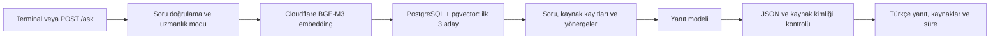

# Akıllı Servis Masası ve Sistem Uzmanı Chatbot

## Güncel uzmanlık bilgi tabanı (6 Kasım 2026)

Yerel bilgi tabanı 446 kayıt içerir: 191 Mendeley ticketı, 156 Windows Server ve 99 Oracle QA. Son seçilmiş 314 uzmanlık adayının tamamı incelendi; 255 kullanımda, 59 dışarıda. Bu belge içindeki eski pilot sayıları tarihsel aşamaları anlatır.

QA kaynak kimliği, soru/cevap yazarları ve ayrı lisanslar korunur. Arama uzmanlık alanına göre filtrelenir; API sources alanı kullanılan kayıtların atıflarını döndürür. Kaynak içeriğinden yeni komut veya kesin çözüm garantisi üretilmez. Son 150 kayıt için resmî karşılaştırmada 137 dar açıklama desteklendi, 13 iddia için yeterli dayanak bulunamadı; ikinci grup kaynak incelemesi onayı kapsamında açıkça işaretlenir.

[Kaynakların kullanımı](UZMANLIK_VERILERININ_KULLANIMI.md), [veri seti hazırlığı](data_sources/README.md) ve [resmî karşılaştırma raporu](RESMI_BELGE_KARSILASTIRMASI_150.md). Ham veri, embedding, yerel DB ve erişim bilgileri Git dışında kalır. Temiz klon 446 kaydı kendiliğinden oluşturmaz.


Teknik destek sorularına geçmiş ticket kayıtlarını kaynak göstererek Türkçe yanıt üreten bir staj projesidir. RAG (Retrieval-Augmented Generation) yaklaşımıyla soru önce bilgi tabanında aranır; bulunan kayıtlar dil modeline bağlam olarak verilir. Kaynaklar üzerinde model eğitimi yapılmaz.

Bu README, 5 Kasım 2026 tarihinde depodaki kod ve geliştirme notları incelenerek hazırlanmıştır. Proje şu anda Windows üzerinde terminalden ve yerel FastAPI servisinden kullanılabilen bir pilottur.

## Mevcut durum

| Bileşen | Durum |
|---|---|
| Kaynaklı soru–yanıt | PostgreSQL + pgvector araması ve bulut model yanıtı bağlı |
| API | `POST /ask`; soru, uzmanlık modu, kaynak kimlikleri ve işlem süresi |
| RAG zinciri | LangChain Runnable ile embedding → arama → yanıt |
| Uzmanlık modları | `service_desk`, `windows_server`, `oracle_db` |
| MSSQL | Kullanıcı, sohbet ve mesaj erişim katmanı hazır; API'ye henüz bağlı değil |
| Arayüz / giriş | Web arayüzü, kullanıcı girişi ve JWT henüz uygulanmadı |

**5 Kasım'daki son yerel veritabanı kontrolünde 191 onaylı/aramaya hazır Mendeley ticket'ı ve 191 chunk doğrulandı.** Önceki 94 kayda son inceleme partisinden 97 uygun kayıt eklendi. Yeni kayıtların her biri için 1024 boyutlu embedding, içerik ve aramaya hazır durum kontrol edildi. Yeni partilerin CSV dosyaları yerel geliştirme klasöründedir; bu commit'e dahil değildir. Depodaki kurulum araçları ve yayımlanmış ek CSV, ilk 20 kaydın hazırlama akışını kapsar; temiz bir klon mevcut 191 kaydı kendiliğinden oluşturmaz.

5 Kasım yerel çalışma notlarında ayrıca **200 Windows Server ve 114 Oracle olmak üzere 314 soru–cevap adayı** indirildiği belirtilir. Bu çalışma henüz commit edilmemiştir; hazırlama araçları ve indirilen veri bu README commit'ine dahil değildir. İndirme notuna göre adaylar `pending` durumundadır; veritabanı kontrolünde de yalnızca Mendeley kaynakları bulunmuştur. Uzmanlık modu seçmek tek başına bu adayları kullanıma açmaz.

## Nasıl çalışır?



1. Soru, Cloudflare Workers AI üzerindeki `@cf/baai/bge-m3` modeliyle 1024 boyutlu vektöre dönüştürülür.
2. `knowledge_chunks` tablosunda cosine benzerliğiyle en yakın üç aday bulunur. Yalnızca `review_status=approved`, `index_status=ready` ve aynı embedding modeline sahip kayıtlar aranır.
3. Soru ve aday kayıtların problem, çözüm, sonuç, onay durumu ve sınırlamaları kodda yapılandırılmış `gpt-5.6-terra` modeline gönderilir. Model erişimi mevcut ChatGPT oturumu üzerinden yapılır.
4. Modelin JSON çıktısı ve kullandığı ticket kimliklerinin adaylar arasında olması kontrol edilir. İlgili kaynak bulunmadığında `insufficient_context=true` beklenir.

Benzerlik skoru doğruluk yüzdesi değildir. Kaynak kimliği kontrolü de yanıtın bütün teknik ayrıntılarının doğru olduğunu tek başına kanıtlamaz. Yönergeler, müşteri onayını destek beyanından ve geçici çözümü kalıcı çözümden ayırmayı ister.

Üç uzmanlık modu aynı kaynak havuzunu arar; henüz moda göre alan filtresi uygulanmaz. Güncel yerel havuz 191 Mendeley kaydıdır. Windows Server ve Oracle modları modele ek yönerge verir; ayrı eğitilmiş modeller değildir.

## Gereksinimler

- Python 3.11 veya üzeri.
- Yerel API'nin kayıtlı oturum akışı için Windows. Kimlik bilgileri Windows hesabına bağlı DPAPI korumasıyla proje dışında saklanır.
- Docker Desktop ve Docker Compose: PostgreSQL 16 + pgvector için.
- Cloudflare Workers AI hesap kimliği ve erişim token'ı; kodun kullandığı modele erişebilen ChatGPT oturumu.
- MSSQL katmanını ayrıca kullanmak için SQL Server ve uygun ODBC sürücüsü. Mevcut yerel kurulum SQL Server 2022 Express ve ODBC Driver 17 kullanır.

Model çağrıları ağ erişimi ve ilgili hesaplarda kullanılabilir erişim/kota gerektirir. Depoda API isteği sırasında etkileşimli giriş başlatılmaz; ilk giriş terminalden yapılır.

## Kurulum ve çalıştırma

Komutlar proje kökünde PowerShell içindir. API'yi çalıştıracağın terminalde de `DATABASE_URL` tanımlı olmalıdır. Python kodu `.env` dosyasını otomatik yüklemez.

### 1. Python ortamı

```powershell
python -m venv .venv
.\.venv\Scripts\python.exe -m pip install -r requirements.txt
```

### 2. Veri dosyaları

Temiz bir klonda aşağıdaki yerel dosyaları ayrıca sağlamalısın:

| Dosya | Kullanımı |
|---|---|
| `tickets_pilot_10.csv` | İlk pilot kayıtları; `issueid`, `problem`, `solution` zorunlu alanlardır |
| `sample_utterances.csv` | Özgün Mendeley yorumları; ek ticket incelemesi ve aktarım kontrolü |
| `outputs_local/ticket_vektorleri.json` | İlk pilotun ürettiği embedding önbelleği |

CSV dosyaları UTF-8 veya UTF-8 BOM biçiminde olmalıdır. İlk pilot ve ham veri Git'e dahil değildir. **`tickets_reviewed_extra.csv` depoda bulunur**, ancak ek aktarım özgün yorumları ve ilk pilot CSV'sini de kontrol eder. Gerekli veriler sağlanmadan veri hazırlama adımları tamamlanamaz.

### 3. PostgreSQL şeması

```powershell
$env:DATABASE_URL = Read-Host "Yerel PostgreSQL baglanti adresi (DATABASE.md kurulumuna gore)"
docker compose up -d
.\.venv\Scripts\python.exe -m database.init_schema
.\.venv\Scripts\python.exe -m database.check_connection
```

Compose dosyasındaki bağlantı bilgileri yerel geliştirme içindir. Port `127.0.0.1:5432` üzerinde açılır ve veriler `postgres_data` volume'ünde saklanır. Şema komutu pgvector uzantısını oluşturduğu için bağlantı kontrolünden önce çalıştırılır.

### 4. İlk pilotu ve ek kayıtları aktar

Hazır ve CSV ile eşleşen bir önbellek yoksa önce embedding üret:

```powershell
.\.venv\Scripts\python.exe ticket_vektor_arama.py
```

Bu araç Cloudflare bilgilerini terminalden ister, 1–10 ticket için vektörleri üretir ve `outputs_local/ticket_vektorleri.json` dosyasına kaydeder. Arama sorusu aşamasına geldiğinde boş Enter ile çıkılabilir. Ardından:

```powershell
.\.venv\Scripts\python.exe -m database.import_pilot
.\.venv\Scripts\python.exe -m database.import_reviewed check
.\.venv\Scripts\python.exe -m database.import_reviewed embed
.\.venv\Scripts\python.exe -m database.import_reviewed import
```

`import_pilot` yeni embedding üretmez; önbelleği kullanır. Ek aktarımda `check` kaynak yorum numaralarını denetler, `embed` ek vektörleri hazırlar, `import` veritabanına yazar. Aynı kaynak sürümü ve ticket kimliğiyle tekrar aktarım kayıtları çoğaltmaz. Hazır bir yerel bilgi tabanını kullanıyorsan bu adımları her açılışta tekrarlaman gerekmez.

### 5. Terminalden giriş ve ilk soru

```powershell
.\.venv\Scripts\python.exe rag_ticket_pilotu.py
```

Terminalde sorunu gir; Cloudflare bilgilerini ve tarayıcıda ChatGPT girişini tamamla. Her çalıştırma tek soru yanıtlar. Windows'ta girişler korumalı olarak saklanır ve API aynı Windows kullanıcısının kayıtlarını kullanır.

```powershell
# Eski bellek içi aramayla karşılaştırma; ilk pilot CSV'si ve önbelleği gerekir
.\.venv\Scripts\python.exe rag_ticket_pilotu.py --memory

# Kayıtlı ChatGPT oturumunu veya Cloudflare bilgisini temizleme
.\.venv\Scripts\python.exe rag_ticket_pilotu.py --oturumu-kapat
.\.venv\Scripts\python.exe rag_ticket_pilotu.py --cloudflare-unut
```

### 6. API'yi başlat

```powershell
.\.venv\Scripts\python.exe -m uvicorn api:app --host 127.0.0.1 --port 8000
```

Etkileşimli API belgesi: [http://127.0.0.1:8000/docs](http://127.0.0.1:8000/docs).

Ayrı bir PowerShell penceresinden örnek istek:

```powershell
$body = @{
    question = "Chrome normal pencerede açılmayan URL gizli pencerede açılıyor. Kaynakta ne denenmiş?"
    expertise_mode = "service_desk"
} | ConvertTo-Json

Invoke-RestMethod -Uri "http://127.0.0.1:8000/ask" -Method Post `
    -ContentType "application/json; charset=utf-8" `
    -Body ([System.Text.Encoding]::UTF8.GetBytes($body)) | Format-List
```

`question` boş olamaz ve en fazla 2000 karakter olabilir. `expertise_mode` gönderilmezse `service_desk` kullanılır; diğer değerler `windows_server` ve `oracle_db` şeklindedir.

| Yanıt alanı | Anlamı |
|---|---|
| `answer` | Kaynaklara dayalı Türkçe yanıt |
| `used_ticket_ids` | Yanıtta kullanılan ticket kimlikleri |
| `insufficient_context` | İlgili kaynak bulunmadığı bilgisi |
| `retrieved_ticket_ids` | Aramanın getirdiği aday kimlikleri |
| `elapsed_ms` | Toplam işlem süresi |
| `expertise_mode` | Seçilen uzmanlık modu |
| `prompt_version` | Kullanılan yönerge sürümü |

Geçersiz soru/mod `422`, kayıtlı girişin hazır olmaması `503`, diğer yanıt üretim hataları `502` döndürür. Kullanıcı yetkilendirmesi henüz bulunmadığı için servis yerel kullanım içindir.

## Veritabanlarının görevleri

**PostgreSQL + pgvector:** `knowledge_sources` kaynağı, `knowledge_records` bütün bilgi kaydını, `knowledge_chunks` aranacak metni ve vektörü tutar. Kısa pilot ticket'larında kayıt başına tek chunk vardır; uzun belge parçalama yaklaşımı henüz değerlendirilmemiştir.

**MSSQL:** `users`, `chat_sessions`, `chat_messages`, `feedback` ve `app_logs` tabloları için şema bulunur. `mssql/repository.py` kullanıcı, sohbet ve mesaj işlemlerini sunar. `/ask` henüz bu katmana yazmaz; sohbet geçmişi, geri bildirim toplama ve kullanıcı doğrulama tamamlanmamıştır.

MSSQL bağlantısı PostgreSQL'den bağımsız `MSSQL_CONNECTION_STRING` ayarını kullanır. Örnek `.env.example` içindedir; bu ayar da ortam değişkenine ayrıca yüklenmelidir. `mssql/schema.sql` yalnızca boş uygulama veritabanında ilk kurulum içindir, tekrar çalıştırılan bir migration değildir. Ayrıntılar: [MSSQL kurulumu ve veri erişimi](mssql/README.md).

## Test ve değerlendirme

Bulut çağrısı yapmadan otomatik testleri çalıştır:

```powershell
.\.venv\Scripts\python.exe -m unittest discover -s tests -v
```

Bu README hazırlanırken depodaki testlerde **9 test geçti, 6 MSSQL entegrasyon testi bağlantı ayarı olmadığı için atlandı**. Bu kontrol canlı model yanıtlarını veya yerel veritabanlarının durumunu doğrulamaz. MSSQL testleri, `MSSQL_TEST_CONNECTION_STRING` tanımlandığında gerçek uygulama veritabanında çalışır; örnek kayıtlar geri alınır.

API açık ve hesap erişimleri hazırken 10 soruluk canlı değerlendirme:

```powershell
.\.venv\Scripts\python.exe evaluate_api.py
```

Bu komut varsayılan V1 sorularıyla bulut çağrıları yapar ve sonuçları `outputs_local/evaluation_results_v1_*.json` dosyasına kaydeder. Yeni 191 ticketlık havuz için hazırlanan V2 setini seçmek için:

```powershell
.\.venv\Scripts\python.exe evaluate_api.py --questions evaluation_questions_v2.json
```

`--output-dir` ile farklı sonuç klasörü seçilebilir. Her soru sonucu hemen kaydedilir; ayrı metadata dosyası soru ve değerlendirme aracı hashlerini, çalıştırma durumunu ve özet ölçümleri saklar. Kaynağa bağlılık ayrıca elle incelenmelidir.

5 Kasım'daki V2 çalıştırmasında 8 ilgili sorunun beklenen kaynağı ilk sırada bulundu; 2 kaynak dışı soruda sistem yanıt uydurmadı. Ortalama süre 9,324 saniyeydi. Elle incelemede 9 yanıt kaynakla uyumlu, 1 yanıt kaynakta doğrulanmayan küçük bir ek ihtimal nedeniyle kısmen uygun bulundu. Bazı kısa yanıtlarda rehberin ek ayrıntıları eksiktir. Bu 10 soru bütün bilgi tabanının doğruluğunu kanıtlamaz. Ayrıntılar: [V2 değerlendirme sonucu](DEGERLENDIRME_V2_SONUCU.md).

9 Ekim'de belgelenmiş önceki değerlendirmede 8 ilgili sorunun beklenen kaynağı ilk sırada bulunmuş, 2 kaynak dışı soru için doğru çekimserlik gözlenmiş ve ortalama süre yaklaşık 10,1 saniye olmuştur. Bunlar mevcut sürüm için yeniden ölçülmüş sonuçlar değildir. Ayrıntılar: [Pilot API ve değerlendirme](PILOT_API_VE_DEGERLENDIRME.md).

## Kod haritası

| Dosya / klasör | Görevi |
|---|---|
| `api.py` | FastAPI istek/yanıt sözleşmesi ve hata kodları |
| `rag_service.py` | Soru doğrulama ve süre ölçümü |
| `rag_chain.py` | RAG adımlarını birleştiren Runnable zinciri |
| `rag_repository.py`, `database/search.py` | PostgreSQL kaynak araması |
| `rag_provider.py` | Kayıtlı kimlik bilgileriyle model erişimi |
| `rag_prompts.py` | Ortak yönerge ve uzmanlık modları |
| `rag_ticket_pilotu.py` | Terminal pilotu, oturum yönetimi, model çıktısı kontrolü |
| `ticket_vektor_arama.py` | İlk pilot embedding önbelleği ve bellek içi arama |
| `ticket_inceleme.py` | Ham yorumlardan manuel inceleme adayları |
| `database/` | PostgreSQL şeması, bağlantı ve veri aktarımı |
| `mssql/` | SQL Server şeması ve kullanıcı/sohbet/mesaj erişimi |
| `tests/` | RAG, prompt ve MSSQL testleri |
| `01_ticket_veri_hazirlama.ipynb` | Ticket veri hazırlama çalışması |

## Sonraki geliştirmeler

- Kullanıcı girişi/JWT ve sahiplik denetimini API'ye bağlamak.
- Sohbet geçmişini, geri bildirimi ve uygulama loglarını MSSQL'e kaydetmek.
- Windows Server ve Oracle adaylarını inceleyip onaylananları kaynak/sürüm/atıf bilgileriyle aramaya aktarmak.
- Alan filtreleri, uzun belgelerde chunk stratejisi ve daha geniş bağımsız test seti hazırlamak.
- Kullanıcı arayüzünü ve dağıtım koşullarını tamamlamak.

## Diğer belgeler

- [PostgreSQL kurulumu](DATABASE.md)
- [RAG akışı](RAG_Akisi.md)
- [ER taslağı](ER_Taslagi.md)
- [Model seçimi](Model_Secimi.md)
- [Uzmanlık yönergeleri](PROMPT_YAPISI.md)
- [Uygulama kararları](KARARLAR_22_EKIM.md)

Tasarım belgelerindeki planlar tamamlanmış özellikler olarak değerlendirilmemelidir. Ham veriler, yerel çıktı dosyaları ve kimlik bilgileri depodan ayrı tutulur.
