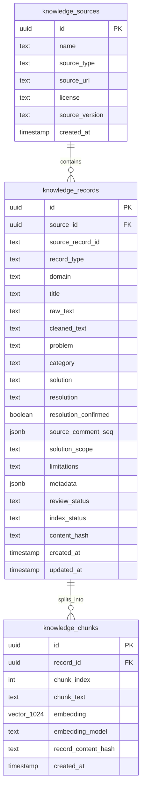
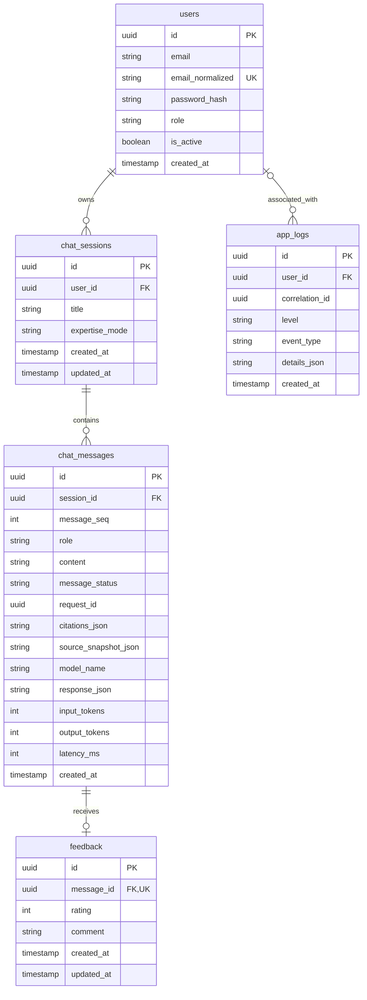
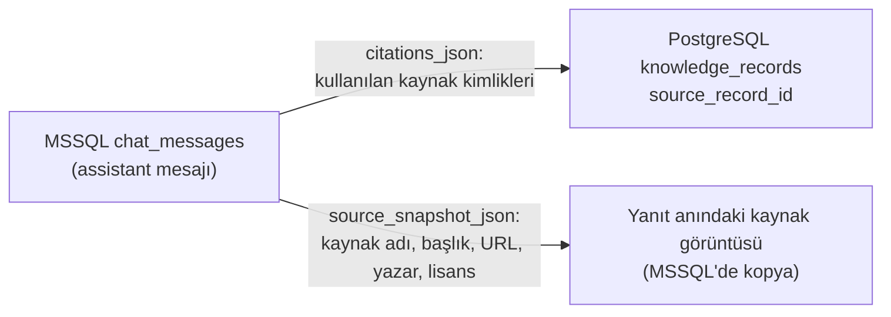

# ER diyagramı — Akıllı Servis Masası ve Sistem Uzmanı Chatbot

Proje: PRJIC20260201 · Tarih: 26 Kasım 2026 · Sürüm: 1.0

Bu belge, çalışan uygulamanın iki veritabanını gösterir:
- **PostgreSQL bilgi tabanı:** 458 onaylı ve aramaya hazır kayıt, 458 chunk.
- **SQL Server uygulama veritabanı `ServisMasasiApp`:** kullanıcılar, sohbetler, mesajlar, yanıt puanları ve uygulama logları. Beş tablonun hepsini çalışan API kullanır.

Fiziksel şemalar:
- [database/schema.sql](../database/schema.sql) (PostgreSQL)
- [mssql/schema.sql](../mssql/schema.sql) (SQL Server)

Akış: [RAG_Akisi.md](RAG_Akisi.md).

## 1. ER neyi gösterir?

ER, hangi bilgilerin hangi tablolarda saklanacağını ve tabloların birbirine nasıl bağlanacağını gösterir. PK, satırın kendi benzersiz kimliğidir. FK, aynı veritabanındaki başka bir tablonun kimliğine bağlanan alandır. 1:N ilişkisi, bir kaynağın birçok kaydı olabilmesi gibi bir ilişkidir.

## 2. Veritabanlarının görevleri

| Veritabanı | Bu taslaktaki görev |
|---|---|
| PostgreSQL + pgvector | Kaynaklar, temizlenmiş bilgi kayıtları, chunk metinleri ve embedding vektörleri |
| MSSQL | Kullanıcılar, sohbetler, mesajlar, yanıt puanları ve uygulama logları |

Proje isterleri PostgreSQL'i ilişkisel veriler ve vektörler, MSSQL'i kullanıcı yönetimi ve loglar için istiyor. Sohbet geçmişi ve geri bildirimlerin de MSSQL'e yerleştirilmesi uygulama tercihidir: bu kayıtlar kullanıcıya aittir ve sahiplik kontrolü kullanıcı tablosuyla aynı veritabanında yapılır.

İki veritabanı arasında FK yoktur. Bağlantıyı uygulama kurar (bkz. Bölüm 4, "Veritabanları arası bağlantı").

## 3. PostgreSQL ER diyagramı

| Tablo | Amacı | Örnek |
|---|---|---|
| `knowledge_sources` | Verinin geldiği kaynağı tanımlar. | Mendeley Help Desk Tickets v3 |
| `knowledge_records` | Bir ticket, uzman soru-cevap kaydı veya doküman bölümünü saklar. | Chrome'da açılmayan URL hakkında temizlenmiş kayıt |
| `knowledge_chunks` | Aramada kullanılacak metin parçalarını ve onların embedding'lerini saklar. | Sorun + çözüm + sonuç + sınırlamalar içeren bir parça |

### Pilot CSV'nin alanları nereye gidecek?

| Pilot CSV alanı | ER karşılığı |
|---|---|
| `issueid` | `knowledge_records.source_record_id` |
| `problem` | `knowledge_records.problem` |
| `category` | `knowledge_records.category` |
| `solution` | `knowledge_records.solution` |
| `resolution` | `knowledge_records.resolution` |
| `resolution_confirmed` | `knowledge_records.resolution_confirmed` |
| `source_comment_seq` | `knowledge_records.source_comment_seq` |
| `solution_scope` | `knowledge_records.solution_scope` |
| `limitations` | `knowledge_records.limitations` |

`id` bizim ürettiğimiz UUID'dir. `source_record_id`, veri setindeki özgün kimliktir; örneğin `1005127.0` metin olarak korunur. Aynı dış kimlik başka veri setinde de bulunabilir; benzersizlik `(source_id, source_record_id)` ile sağlanır. Bir ticketı ileride ayrı sorun kayıtlarına bölersek bu kural alt kayıt anahtarı eklenerek güncellenir.

Ticket ve soru-cevap kayıtları için sorun/çözüm alanları kullanılır. Resmî doküman bölümlerinde `title` ve `cleaned_text` asıl içeriktir; ticketa özgü alanlar boş olabilir. Dokümana yapay bir ticket çözüm bildirimi eklenmez. `resolution_confirmed` bu yüzden boş/true/false değerlerini destekler; true kaynakta başarı bildirimi olduğunu ifade eder.

`domain`: `general_it`, `windows_server`, `oracle_db`. `record_type`: `ticket`, `qa`, `documentation`. Kategori bu alanlardan ayrıdır; örneğin `Browser / Access`.

`metadata`, kayıt URL'si, yazar/atıf bilgisi, kaynak tarihi, ürün sürümü, dil, çıkarım modeli ve prompt sürümü gibi kaynak türüne göre değişen bilgileri taşır. Ham kaynak dosya ayrıca korunur. `raw_text`, bu kayda karşılık gelen yeniden birleştirilmiş özgün metindir.

`review_status`: `pending`, `approved`, `excluded`. `index_status`: `pending`, `ready`, `error`. Eksik/şüpheli çıkarımlar pending kalır. Başarı bildirimi olmayan bir kayıt, kapsamı ve sınırlamaları açıkça belirtilen yararlı bir teşhis kaydı olarak inceleme sonunda onaylanabilir.

### Temel bütünlük kuralları

- Her kayıt tek bir kaynağa; her chunk tek bir kayda bağlanır.
- `(record_id, chunk_index)` benzersizdir.
- Çalışan PostgreSQL şemasında pgvector alanı `vector(1024)` olarak oluşturulmuştur. Cloudflare `@cf/baai/bge-m3` embedding'leri ve model kimliği chunk ile birlikte saklanır; farklı embedding modelleri aynı aramada karıştırılmaz. Model gerekçesi [Model_Secimi.md](Model_Secimi.md) dosyasındadır. RAG yanıtı için `gpt-5.6-terra` erişimi yerel pilotta doğrulanmıştır.
- Metin ve embedding aynı chunk satırında tutulur. Sadece `review_status=approved` ve `index_status=ready` olan kayıtlar aramaya alınır.
- **Kayıt–vektör tutarlılığı:**
  - Her chunk, üretildiği andaki kayıt hash'ini `record_content_hash` alanında taşır.
  - Arama yalnızca `record_content_hash = knowledge_records.content_hash` olan chunk'ları kullanır. Kayıt metni değişip vektör yenilenmediyse eski vektör aramaya girmez.
  - Chunk yazımı ve kaydın `ready` durumuna geçmesi aynı PostgreSQL transaction'ındadır. Başarısız işlemde yarım bir chunk aramaya açılmaz.
- Model değiştiğinde aynı boyutta olsa bile eski ve yeni modellerin vektörleri aynı aramada karıştırılmaz (`embedding_model` filtresi); ilgili indeks yeniden üretilir.
- `knowledge_chunks → knowledge_records` bağlantısı `ON DELETE CASCADE`, `knowledge_records → knowledge_sources` bağlantısı `ON DELETE RESTRICT` kuralıyla tanımlıdır. Uygulama kayıt silmez; aramadan çıkarılacak kayıt `excluded` yapılır.

## 4. MSSQL ER diyagramı

Bu diyagramdaki tipler okunabilirlik için kavramsal kısa adlarla gösterilir. Uygulanan fiziksel şema [mssql/schema.sql](../mssql/schema.sql) dosyasındadır: UUID için `uniqueidentifier`, uzun metin için `nvarchar(max)`, tarih için `datetime2(3)`, boolean için `bit` kullanılır. `email_normalized`, e-postanın baş/son boşlukları çıkarılıp küçük harfe dönüştürülen hesaplanmış alanıdır; benzersizlik bu alan üzerinde sağlanır. Bu alan ve e-posta sorgusu `Latin1_General_100_CI_AS_SC` kuralını kullanır; Türkçe veritabanı ayarının `I/ı` dönüşümünden etkilenmez.

| Tablo | Amacı |
|---|---|
| `users` | Kayıt/giriş, kullanıcı ve admin rolü |
| `chat_sessions` | Kullanıcıya ait sohbet ve seçilen uzmanlık modu |
| `chat_messages` | Sıralı kullanıcı/bot mesajları, kullanılan kaynaklar ve model ölçümleri |
| `feedback` | Bot yanıtına verilen 1–5 puan ve isteğe bağlı yorum |
| `app_logs` | Giriş, veri yükleme, yanıt üretme veya hata gibi uygulama olayları |

### Temel kurallar

- **E-posta ve parola:**
  - E-posta normalize edilir ve benzersiz tutulur.
  - Parola metni saklanmaz. `password_hash` alanında `pbkdf2_sha256$600000$<salt>$<özet>` biçimi tutulur: her parola için 16 bayt rastgele salt ve 600.000 turlu PBKDF2-HMAC-SHA256.
  - Doğrulama aynı salt ve tur sayısıyla yeniden hesaplanıp sabit zamanlı karşılaştırmayla yapılır; özet geri döndürülemez.
- **Alan değerleri:** `users.role`: `user`, `admin`. `chat_sessions.expertise_mode`: `service_desk`, `windows_server`, `oracle_db`. `chat_messages.role`: `user`, `assistant`.
- **Sahiplik:** Mesaj sırası için `(session_id, message_seq)` benzersizdir. JWT'deki kullanıcı kimliği ile sohbet sahibinin eşitliği her sohbet okuma/yazma işleminde kontrol edilir. Başkasının sohbeti, bulunmayan sohbetle aynı 404 yanıtını alır.
- **Mesaj durumu:** `message_status` mesaj durumunu (`pending`, `completed`, `error`), `request_id` ise istemcinin gönderdiği istek kimliğini tutar. Aynı istek kimliği ve aynı soruyla gelen tekrar, kayıtlı yanıtı döndürür; model yeniden çağrılmaz.
- **Yanıt ölçümleri:** `response_json` API'nin tam yanıtını (kaynak kimlikleri, `insufficient_context`, prompt sürümü) saklar; admin raporu "kaynaklı yanıt oranı"nı buradan hesaplar. `latency_ms` yanıt süresini tutar. `input_tokens` ve `output_tokens` şemada vardır ama şu an doldurulmaz.
- **Puanlar:** Puan 1–5 arasındadır. Yalnızca assistant mesajı ve ilgili sohbetin sahibi için puan kabul edilir. Mesaj başına en fazla bir puan vardır; kullanıcı kendi puanını güncelleyebilir.
- **Loglar:** Anonim/giriş öncesi olaylar için `app_logs.user_id` boş olabilir. Log ayrıntıları olay bilgisi ve aşama sürelerini içerir. Parola, JWT, API anahtarı, soru ve yanıt metni yazılmaz; gizli anahtar adları `[gizli]` olarak maskelenir.

### Veritabanları arası bağlantı

- `citations_json`, yanıtta kullanılan PostgreSQL kayıt kimliklerini (`source_record_id`) saklar. Bu bağlantı FK değildir; uygulama yönetir.
- `source_snapshot_json`, yanıtta kullanılan kaynakların türünü, alanını, başlığını, kaynak adını, URL'sini ve yazar/lisans bilgisini saklar. Kaynak kayıt sonradan değişse veya aramadan çıkarılsa da eski yanıtın hangi kaynağa dayandığı görülebilir. Kaynak metni, ham veri veya gizli bilgi kopyalanmaz.
- Soru, yanıt ve kaynak görüntüsü tek MSSQL transaction'ında yazılır. Model çağrısı bu transaction'ın dışındadır.

## 5. Gereksinimlerle eşleme

| Proje gereksinimi | Karşılık |
|---|---|
| Temiz açıklama ve çözüm | `knowledge_records` |
| Chunk + embedding + vektör arama | `knowledge_chunks` |
| Kaynak, atıf ve ürün sürümü | `knowledge_sources` + kayıt `metadata` alanı |
| Windows/Oracle modu | Kayıt `domain` alanı + sohbet `expertise_mode` alanı |
| Kullanıcı kayıt/giriş ve yetkilendirme | `users` + API/JWT kontrolü |
| Sohbet geçmişi ve önceki mesajlar | `chat_sessions` + `chat_messages` |
| Yanıt puanlama | `feedback` |
| Admin raporları ve loglama | Mesajlar + puanlar + `app_logs` |

Admin panelinde puanların özeti kullanıcı geri bildirimi olarak gösterilir. Örneğin olumlu puan oranı, puan veren kullanıcılar arasındaki orandır; tek başına teknik doğruluk oranı veya sorunun çözüldüğü anlamına gelmez. Teknik başarı ayrıca proje test raporuyla ölçülecek.

## 6. Güncel yerleşim (26 Kasım 2026)

**PostgreSQL** (Docker, `pgvector/pgvector:pg16`, yalnız `127.0.0.1:5432`): 458 kayıt ve 458 chunk vardır; hepsi `approved/ready` durumunda ve `@cf/baai/bge-m3` vektörlüdür. Kayıt dağılımı:

| `domain` | `record_type` | Kayıt |
|---|---|---|
| `general_it` | `ticket` | 191 |
| `windows_server` | `qa` | 156 |
| `windows_server` | `documentation` | 5 |
| `oracle_db` | `qa` | 99 |
| `oracle_db` | `documentation` | 7 |

`1005127.0` gibi özgün kimlikler `source_record_id` alanında korunur. Her kayıt tek arama chunk'ıdır; çoklu chunk desteği şemada vardır ama kullanılmıyor (gerekçe: [RAG_Akisi.md](RAG_Akisi.md), Bölüm 1).

**SQL Server 2022 Express** (`.\SQLEXPRESS`, veritabanı `ServisMasasiApp`, karşılaştırma kuralı `Turkish_CI_AS`, AUTO_CLOSE kapalı): Veritabanı 26 Kasım'da yeni Windows kurulumunda `mssql/schema.sql` ile yeniden kuruldu. Veri dosyaları sunucunun D: sürücüsündeki varsayılan klasöründedir. Gerçek SQL üzerinde 88 entegrasyon testi ve 6 veri erişim testi geçti; test kayıtları geri alındı. Tablolar şu işlevlerle kullanılır:
- Kayıt/giriş: `users`
- Kalıcı sohbet: `chat_sessions`, `chat_messages`
- Yanıt puanlama: `feedback`
- Uygulama günlüğü: `app_logs`
- Admin raporu: bu tabloların hepsinden okur.

Katmanın kullanımı [mssql/README.md](../mssql/README.md) içindedir.
