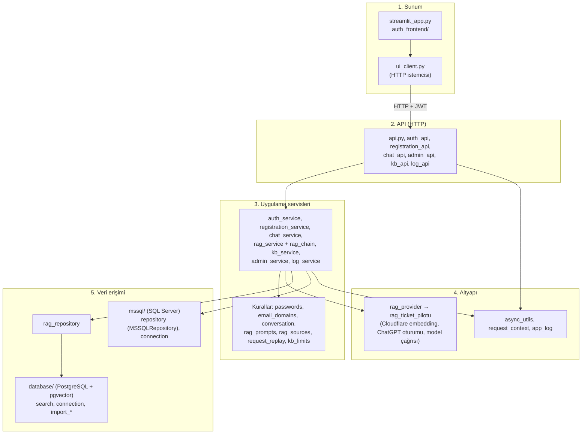

# Uygulama mimarisi — Akıllı Servis Masası ve Sistem Uzmanı Chatbot

Proje: PRJIC20260201 · Tarih: 26 Kasım 2026 · Sürüm: 1.0

Proje isterleri "n-katmanlı mimari veya microservices (modüler yapı)" istiyor. Uygulama **tek süreçli, n-katmanlı** bir yapıdadır: bir FastAPI süreci ve ayrı çalışan bir Streamlit arayüzü vardır. Microservices kullanılmadı. Gerekçe: proje tek geliştirici tarafından, tek bilgisayarda (8 GB RAM) geliştirildi ve yerel çalışıyor; servisleri ayırmanın getireceği ağ, dağıtım ve izleme yükü bu ölçekte fayda sağlamaz.

Bu belge dosyaları katmanlara eşler, katmanlar arası kuralları ve bilinen sapmaları açıklar. Veri akışı: [RAG_Akisi.md](RAG_Akisi.md). Veritabanları: [ER_Taslagi.md](ER_Taslagi.md).

## 1. Katmanlar

| Katman | Dosyalar | Sorumluluk | Bilmediği şeyler |
|---|---|---|---|
| **1. Sunum** | `streamlit_app.py`, `ui_client.py`, `auth_frontend/` | Ekranlar, form doğrulama, oturum belleğinde JWT tutma, API'ye HTTP isteği | Veritabanı, model, parola özeti. Arayüz yalnız API üzerinden çalışır. |
| **2. API** | `api.py`, `auth_api.py`, `registration_api.py`, `chat_api.py`, `admin_api.py`, `kb_api.py`, `log_api.py` | İstek/yanıt sözleşmesi (Pydantic), kimlik ve rol kontrolü (`require_user`, `require_admin`), hata → HTTP kodu eşlemesi, korelasyon kimliği | SQL sorguları, prompt, embedding |
| **3. Uygulama servisleri** | `auth_service.py`, `registration_service.py`, `chat_service.py`, `rag_service.py`, `rag_chain.py`, `kb_service.py`, `admin_service.py`, `log_service.py` | İş kuralları: sohbet sahipliği, kayıt transaction'ı, RAG zinciri, tekrar koruması, Bilgi Merkezi onay akışı | HTTP ayrıntıları |
| | `passwords.py`, `email_domains.py`, `conversation.py`, `rag_prompts.py`, `rag_sources.py`, `request_replay.py`, `kb_limits.py` | Yan etkisi olmayan kurallar: parola özeti, e-posta uzantısı, geçmiş sınırları, uzmanlık yönergeleri, kaynak atıfı | Veritabanı ve ağ |
| **4. Altyapı** | `rag_provider.py`, `rag_ticket_pilotu.py`, `ticket_vektor_arama.py` | Dış servis istemcileri: Cloudflare embedding, ChatGPT oturumu (DPAPI), OpenAI Responses çağrısı ve çıktı doğrulaması | İş kuralları |
| | `async_utils.py`, `request_context.py`, `app_log.py` | Asenkron çalışma kuralları, istek başına korelasyon ve aşama süreleri, arka planda log yazımı | — |
| **5. Veri erişimi** | `database/`, `rag_repository.py` | PostgreSQL bağlantısı, pgvector araması, bilgi tabanı aktarımı | İş kuralları |
| | `mssql/` | SQL Server bağlantısı ve parametreli sorgular (`MSSQLRepository`) | İş kuralları |

Yardımcı ve tek seferlik araçlar katmanların dışındadır:
- `evaluate_api.py`: değerlendirme
- `plus_erisim_testi.py`: ilk erişim denemesi
- `data_sources/`: dış kaynak indirme
- `scripts/`: eski veri hazırlama betikleri

## 2. Katmanlar arası kurallar

1. **Bağımlılık yönü yukarıdan aşağıdır.** Sunum yalnız API'yi bilir. API servisleri çağırır. Servisler veri erişimini ve altyapıyı kullanır. Alt katman üst katmanı import etmez.
2. **Kimlik yalnız API katmanında belirlenir.** Kullanıcı kimliği JWT'den alınır (`require_user`) ve servise parametre olarak verilir. Servisler istemcinin gönderdiği `user_id` değerine güvenmez; böyle bir alan istek modellerinde yoktur.
3. **SQL yalnız veri erişim katmanında yazılır.** MSSQL sorguları `mssql/repository.py` içinde toplanır ve kullanıcı girdisi sorgu metnine değil parametreye gider. Transaction sınırını servis belirler: commit ve rollback servisin işidir, repository bunları çağırmaz.
4. **Uzun süren dış çağrılar transaction içinde yapılmaz.** Model çağrısı sırasında SQL bağlantısı açık tutulmaz (`chat_service.answer_chat_async`).
5. **Olay döngüsü bloklanmaz.** Bütün HTTP uçları `async def`'tir. Eşzamanlı sürücüler (pyodbc, DPAPI, parola özeti) `async_utils.run_blocking` ile sınırlı bir iş parçacığı havuzunda çalışır. Model çağrıları `llm_gate` eşzamanlılık kapısından geçer.
6. **Gizli bilgi katman dışına sızmaz.** Hata mesajları bağlantı dizesi, token veya parola içermez. `app_log` gizli anahtar adlarını maskeler; soru ve yanıt metni loglanmaz.

## 3. SOLID ve Clean Code karşılıkları

| İlke | Koddaki karşılığı |
|---|---|
| Tek sorumluluk (S) | Her API dosyası bir uç grubunu, her servis bir iş alanını kapsar: auth, kayıt, sohbet, RAG, Bilgi Merkezi, rapor, log. Parola kuralları (`passwords.py`) ve e-posta kontrolü (`email_domains.py`) ayrı modüllerdir. |
| Açık/kapalı (O) | Yeni bir uzmanlık modu, `rag_prompts.py` içine yönerge ve `ExpertiseMode` değeri eklenerek tanımlanır. RAG zinciri ve arama kodu değişmez, alan filtresi moddan türetilir. |
| Bağımlılıkların tersine çevrilmesi (D) | `kb_service.approve_record(connection, record_id, embed)` embedding fonksiyonunu parametre olarak alır. Testler sahte embedding verir, API gerçek sağlayıcıyı verir. Servisler bağlantıyı ve repository'yi parametre olarak alır. |
| Arayüz ayrımı (I) | Arayüz, API ile yalnız `ui_client.py` üzerinden konuşur. Streamlit kodu HTTP ayrıntısını bilmez. |
| Test edilebilirlik | 201 birim testi: sahte bağlantı, sahte model ve sahte API ile. Gerçek SQL/PostgreSQL testleri ortam değişkeniyle açılır ve rollback ile iz bırakmaz. |
| Okunabilirlik | Modüllerin başında görevini anlatan açıklama vardır; kullanıcıya dönen hata mesajları Türkçe ve gizli bilgi içermez. |

## 4. Bilinen sapmalar

Aşağıdaki noktalar katman kurallarına tam uymaz. Çalışmayı bozmazlar, ancak teslim sonrası iyileştirme adayıdırlar.

| Sapma | Neden oldu | Etki | Önerilen düzeltme |
|---|---|---|---|
| `rag_ticket_pilotu.py` (714 satır) hem terminal pilotu, hem ChatGPT/DPAPI oturum yönetimi, hem model çağrısı ve çıktı doğrulamasıdır. `rag_provider.py` ve `rag_repository.py` bu dosya üzerinden çalışır. | Uygulama ilk terminal pilotundan büyüdü; çalışan ve testli giriş kodu yeniden yazılmadı. | Dosya birden çok sorumluluk taşır; değişiklik riski yüksektir. | Oturum yönetimini, OpenAI istemcisini ve terminal arayüzünü ayrı modüllere bölmek. |
| Embedding istemcisi eski pilot betiği `ticket_vektor_arama.py` içindedir; `kb_service` ve `database/import_*` bunu import eder. | Aynı nedenle | Veri erişim katmanı bir pilot betiğine bağlı | `cloud_embeddings` fonksiyonunu ayrı bir altyapı modülüne taşımak |
| `kb_api.py` PostgreSQL bağlantısını ve transaction'ı API katmanında açar ve `kb_service` fonksiyonlarına verir. | Bilgi Merkezi hızlı eklendi; servis bağlantıyı parametre olarak alacak şekilde yazıldı. | Transaction sınırı API'de; diğer alanlarda bu sınır serviste | Bağlantı yönetimini `kb_service` içine (diğer servislerdeki `_run` kalıbına) taşımak |
| Bütün modüller ana klasörde düz durur (paket yapısı yok). | Kademeli büyüme | Katmanlar dosya adlarından anlaşılıyor ama klasör yapısı bunu göstermiyor | `app/api`, `app/services`, `app/infra` paketlerine taşımak. Çok sayıda import değiştiği için ayrı ve testli bir iş olarak yapılmalı. |

## 5. Çalışma zamanı bileşenleri

| Süreç | Başlatma | Adres |
|---|---|---|
| FastAPI | `start_api.ps1` (uvicorn) | `127.0.0.1:8000` |
| Streamlit | `python -m streamlit run streamlit_app.py` | `127.0.0.1:8501` |
| PostgreSQL 16 + pgvector | `docker compose up -d` | `127.0.0.1:5432` |
| SQL Server 2022 Express | Windows hizmeti `MSSQL$SQLEXPRESS` | `.\SQLEXPRESS` |
| Cloudflare Workers AI, OpenAI Responses API | Dış servis | İnternet |

Bütün yerel servisler yalnızca `127.0.0.1` üzerinde dinler. Kurulum adımları [README.md](../README.md) içindedir.
